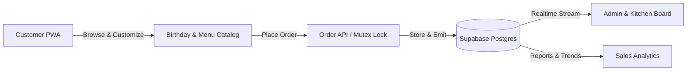
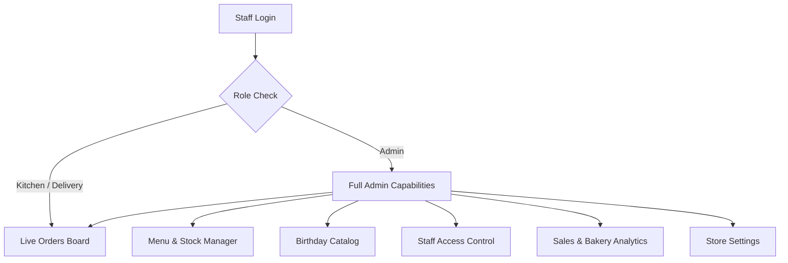
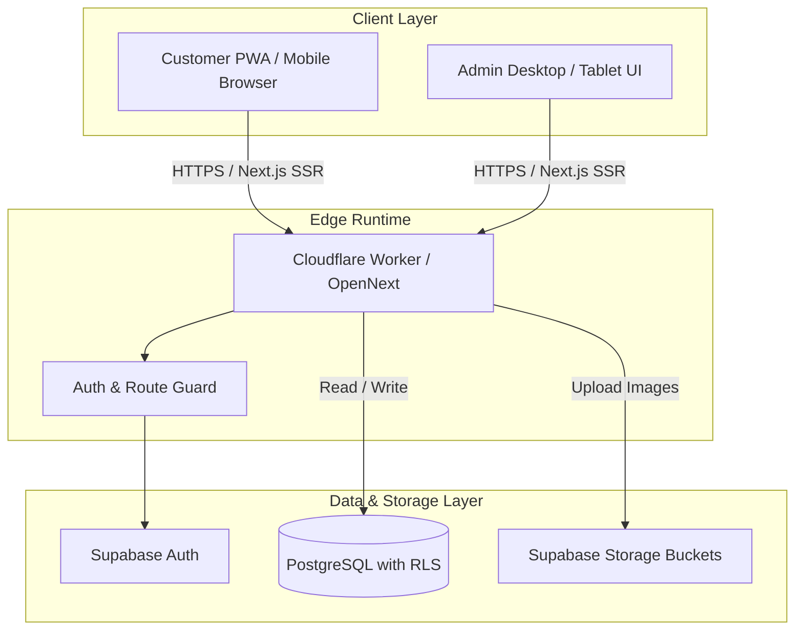
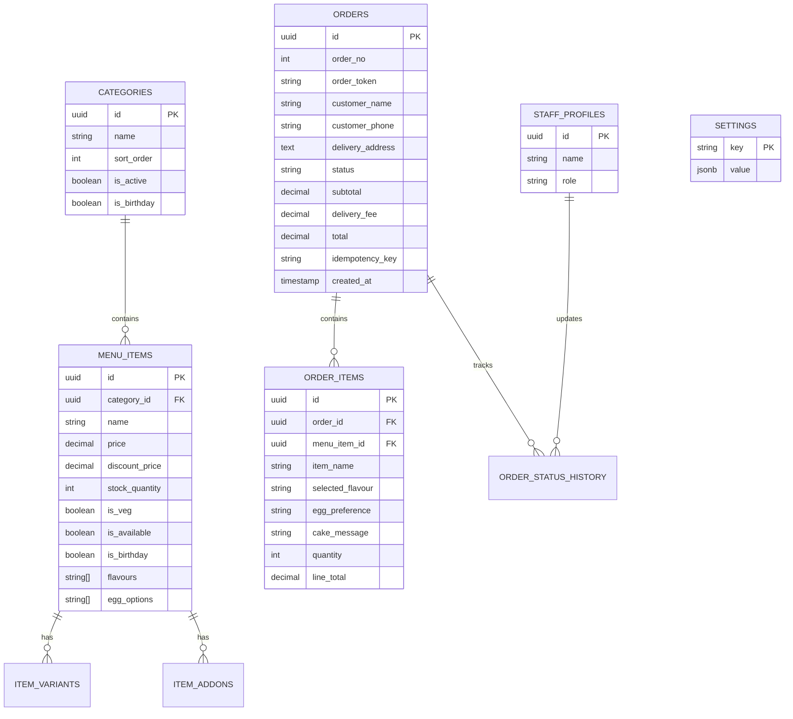

# Product Requirements Document (PRD)
## Baker's Nation — Food Ordering & Bakery System

---

## 1. Executive Summary

**Baker's Nation** is a modern, high-speed Progressive Web Application (PWA) designed for local bakeries to take direct online orders for freshly baked items (cakes, pastries, breads, pizzas) and curated **Birthday Celebration Packages**. 

The platform eliminates high aggregator commissions, delivers sub-second menu browsing, prevents duplicate orders during network latency, and equips bakery staff with a real-time kitchen display, delivery routing, and revenue analytics.

---

## 2. Product Objectives & Success Metrics

| Goal | Target Metric |
| :--- | :--- |
| **Instant Menu Loading** | First Contentful Paint (FCP) < 1.2s on mobile 4G |
| **High Cart Conversion** | 3-step checkout with zero mandatory upfront login |
| **Zero Duplicate Orders** | 100% idempotency enforcement across retries and double taps |
| **Accurate Kitchen Fulfillment** | Live status transitions (Placed ➔ Confirmed ➔ Delivered) |
| **Operational Independence** | 100% serverless hosting via Cloudflare Workers + Supabase |

---

## 3. Target User Personas

1. **The Walk-in & Online Customer**
   - Wants quick ordering for delivery or takeaway.
   - Requires customization for cakes (egg/eggless, flavor, custom message, photo reference).
   - Needs live order tracking via a single link without remembering passwords.

2. **The Bakery Kitchen & Counter Staff**
   - Needs an audio-enabled, real-time board showing incoming orders.
   - Quickly updates statuses (`confirmed`, `preparing`, `delivered`).

3. **The Bakery Owner / Admin**
   - Updates prices, stock availability, and shop status (Open/Closed).
   - Tracks daily, weekly, and monthly revenue, bestseller dishes, and inventory warnings.
   - Manages team members and access roles.

---

## 4. Feature Specifications

### 4.1 Customer Experience

#### A. Menu & Browsing
- **Category Tabs**: Dynamic pills for fast filtering (Cakes, Pastries, Pizza, Bread, etc.).
- **Dietary Filter**: Veg and Non-veg toggles with color-coded badges.
- **Product Details**: Multi-image carousel, discount pricing badge, variants (e.g., 500g, 1kg), and add-ons (extra toppings, gift wraps).
- **Search**: Instant client-side fuzzy search by dish name.

#### B. Birthday Celebration Package Builder (`/birthday`)
- **Package Flow**: Allows customers to assemble an all-in-one party package in one view.
- **Custom Cake Builder**:
  - Flavours (Chocolate, Vanilla, Red Velvet, Pineapple, Black Forest, Butterscotch, Strawberry, Mango, Fruit).
  - Egg preference: 100% Eggless or Contains Egg.
  - Custom Cake Message: Up to 50 characters with preview.
  - Reference Image Upload: Custom photo or theme inspiration.
- **Party Essentials**: Multi-item bundle selection (Balloons, Number Candles, Caps, Banners, Poppers).
- **Sticky Summary Pill**: Real-time total calculation with a single tap to push the entire package to the cart.

#### C. Smart Cart & Checkout (`/cart`, `/checkout`)
- **Minimum Order Validation**: Enforced at checkout (Default: ₹200).
- **Dynamic Delivery Fee**: Auto-calculated based on store settings (Default: ₹10).
- **Customer Form**: Name, 10-digit Indian mobile number (`^[6-9]\d{9}$`), address, and special instructions.
- **Idempotency Guard**: Client-generated unique token prevents duplicate deductions or double bookings.
- **PWA Install Guide**: Native, non-intrusive modal guiding iOS Safari, Android Chrome, and Desktop users to install the web app.

#### D. Live Order Tracking (`/order/[token]`)
- Passwordless, secure access via an unguessable 64-character token.
- Visual timeline: `Placed` ➔ `Confirmed` ➔ `Preparing` ➔ `Out for Delivery` ➔ `Delivered`.
- Summary of ordered items, customizations, delivery address, and store helpline.

---

### 4.2 Staff & Administration Panel (`/admin`)

#### A. Live Orders Kanban (`/admin/orders`)
- Realtime polling and Supabase Postgres changes subscription.
- Audio doorbell notifications on incoming orders: Synthesizes a loud, sharp two-tone doorbell chime ("Ding-Dong!" at 1175Hz / 880Hz, repeating twice for 3 seconds) via Web Audio API + /bell.mp3 fallback with mobile haptic vibration and an interactive "Test" control.
- Role-based transition actions:
  - Admin: Can confirm, cancel, advance, or mark delivered.
  - Kitchen Staff: Can advance preparation states.
  - Delivery Staff: Can view delivery address and mark delivered.

#### B. Client Records & CRM (`/admin/clients`)
- **Customer Directory & Logs**: Tracks who ordered what, exact order dates (IST), full item breakdown, flavours, cake messages, and delivery address.
- **Direct Engagement**: 1-click WhatsApp and Phone call actions per client.
- **Repeat Buyer Insights**: Lifetime spending, order count, and VIP repeat client badges.
- **Export**: One-click CSV export of client history and order records.

#### C. Menu & Stock Management (`/admin/menu` & `/admin/birthday`)
- Quick toggle for item availability (`In Stock` / `Out of Stock`).
- Price and discount price editor with instant margin calculation.
- Direct image upload with automated storage bucketing.

#### C. Sales & Bakery Analytics (`/admin/reports`)
- **Granular Ranges**: Today, Yesterday, Last 7 Days, This Month.
- **Top 4 KPI Cards**: Total Revenue, Active Orders, Average Order Value (AOV), Cancelled Orders.
- **Interactive Visualizations**: Daily, Weekly, and Monthly sales trends.
- **Demand Breakdown**: Best-selling items and revenue share per category.
- **Stock Warnings**: Auto-alerts for items with inventory $\le 5$ units.

#### D. Operational Store Settings (`/admin/settings`)
- **Master Store Toggle**: Instantly toggle `Shop Open` / `Shop Closed` (locks checkout with a friendly notice).
- **Order Constraints**: Minimum order amount and flat delivery fee.
- **Contact Info**: Restaurant display name and helpline phone number.

---

## 5. Technical Architecture

### 5.1 Tech Stack
- **Framework**: Next.js 15 (App Router, Turbopack, React 19)
- **Deployment Adapter**: `@opennextjs/cloudflare` + Cloudflare Workers
- **Database & Auth**: Supabase PostgreSQL + Row Level Security (RLS)
- **State & Forms**: Zustand (Cart), React Hook Form, Zod
- **Styling & UI**: Tailwind CSS v4, Radix UI, Lucide Icons, Sonner
- **PWA Engine**: Serwist (Service Worker caching, offline fallback)

---

## 6. Database Schema Overview

---

## 7. Security & Non-Functional Requirements

1. **Row Level Security (RLS)**:
   - Customers can only read public active menu items and their own order via cryptographic tokens (`order_token`).
   - Mutations on status, reports, and staff management require authenticated admin sessions.
2. **Server-Side Key Isolation**:
   - `SUPABASE_SERVICE_ROLE_KEY` is strictly confined to server-side routes and never bundled into client JavaScript.
3. **Resilience & Fallbacks**:
   - Cloudflare server runtime gracefully recovers with encoded default service credentials if dashboard environment variables are omitted.
4. **Idempotency & Concurrency**:
   - Double clicks and flaky network retries within a 60-second window resolve to the original order record without charging or inserting duplicate rows.

---

## 8. Release Milestones & Roadmap

- [x] **v1.0 (Core Food Ordering)**: Menu display, Cart, Checkout, Live Orders Board, Cash on Delivery.
- [x] **v1.1 (Bakery & Birthday Upgrade)**: Birthday Celebration packages, Custom Cake Builder, Multi-flavor selection, Low stock alerts.
- [x] **v1.2 (Cloudflare Migration)**: Serverless deployment via OpenNext on Cloudflare Workers, PWA manual installation modal, Sales Analytics Dashboard.
- [ ] **v1.3 (Future Enhancements)**:
  - Online UPI / Razorpay payment gateway integration.
  - Automated WhatsApp order notification via Twilio/Gupshup.
  - Delivery agent GPS live location sharing.
